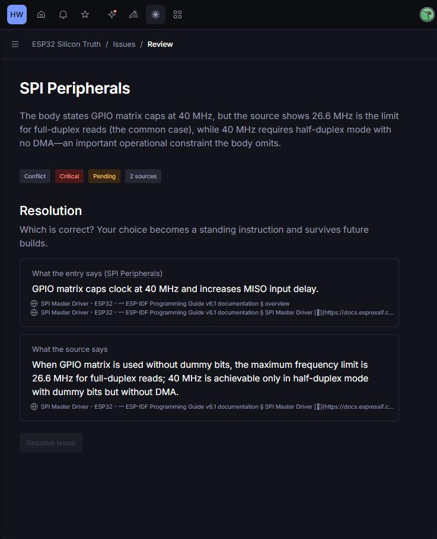

*This is a submission for the [Sanity Challenge, Path One: Ship an Agent That Queries Real Content](https://dev.to/challenges/sanity-2026-09-16)*

## What I Built

**Errata Lens** answers ESP32 questions the way a careful senior engineer does: it checks whether the chip's **errata** overrides the **datasheet**, for the **exact silicon revision** on your board.

That last part is the whole problem. The ESP32 has shipped in five silicon revisions (v0.0 → v3.1). Some bugs were fixed in v1.0, some in v3.0, some were never fixed, and at least one (WDT-3.15, a live-lock watchdog issue) only *appears* on v3.x. The datasheet reads the same for all of them. Ask a normal chatbot "can I rely on GPIO36 as an input with Wi-Fi on?" and you get the datasheet answer, which is how people lose a week to an 80 ns glitch (GPIO-3.11).

I'm a computer engineering student who writes Verilog and firmware, and this is the tool I wanted on the bench.

**Try asking it:**
- "Reading a sensor on GPIO36 with Wi-Fi on, I get random low glitches. Why?"
- "Chip is ESP32-D0WD (revision v1.1). Is PSRAM safe?"
- "Should we move our product from v1.1 to v3.1? What do we gain and what new bugs do we get?"

## Demo

<!-- TODO: deployed URL + 60–90 s video: pick revision → ask GPIO36 question → expand the tool badges to show the GROQ query and KB entries → answer card -->

## Code

<!-- TODO: GitHub repo link -->

## How I Used Sanity

Two Sanity Context MCP endpoints, one per retrieval mode, because the problem has two halves.

**1. Knowledge Base mode: reconciling prose that disagrees.**
I pointed a Knowledge Base ("ESP32 Silicon Truth") at two crawls: the Espressif errata site (47 pages) and the ESP-IDF peripheral driver docs (25 pages). The build distilled 118 documents into 23 entries, tagging the errata topics `[core]` because the Knowledge Base's purpose names them.

The build also caught a real contradiction I would have missed. The drafted SPI entry said the GPIO matrix caps SPI at **40 MHz**. The source says that's only true in half-duplex mode without DMA. For ordinary full-duplex reads the limit is **26.6 MHz**. Context raised it as a *Critical* conflict with both claims and their citations side by side:



I picked the source's claim, and it became a standing instruction that survives rebuilds. I also wrote one by hand for GPIO-3.11, anchored to the errata page and the GPIO driver page: when they disagree, the errata wins for the revisions it lists.

A plain vector index over these pages would hand the agent both numbers and hope it picked right. Here the conflict gets settled once, at build time, by a person.

The agent calls `initial_context` for the outline, then `knowledge_base_read` with several entry paths in one call (or `knowledge_base_search` when the outline doesn't make the location obvious).

**2. GROQ mode: revision math that a keyword search can't do.**
In the dataset, each `erratum` references the `chipRevision` documents it affects, plus `introducedIn` / `fixedIn`. Each revision stores its chip-marking letter, module code and eFuse signature. That turns questions into joins:

```groq
// Bugs on my v1.1 that v3.1 fixes → CPU-3.9, CPU-3.10, RES-3.8
*[_type=="erratum" && references("rev-esp32-v1-1")
  && !references("rev-esp32-v3-1")]{errataId, title, fixedIn}
```

One gotcha worth sharing: my first version filtered with `"v1.1" in affectedRevisions[]->name`. It works against the Content Lake directly, but through the Context GROQ endpoint it silently returned **zero results**. The endpoint rewrites dereferences into projections (`->{"name": name}`), so the `in` compared a string against objects. Switching to `references()` on the stable revision document IDs fixed it, and the system prompt now tells the agent to do the same.

Keyword search can find "PSRAM". It can't tell you that CPU-3.9 applies to your v1.0/v1.1 board but not v3.x, or that upgrading brings in WDT-3.15. Structure can.

**3. A small local tool** parses esptool output, ESP-IDF boot logs, and module markings (`MF`/`ME`/`MG`) into a revision, so users can paste what they already have.

**Answer shape.** Every answer has the same four parts: Answer → Docs say → Errata override (with erratum IDs + links) → Your revision. The UI shows each MCP call as an expandable badge, so you can see the GROQ query and which KB entries were read.

**Stack:** Next.js 16, Vercel AI SDK 6 (`@ai-sdk/mcp`), Claude, Sanity Studio 6.

## Sanity Project Details

Project ID: `ziyzznsh`, dataset `production` (public). Try it: https://ziyzznsh.api.sanity.io/v2025-01-01/data/query/production?query=*[_type=="erratum"][0...5]{errataId,title,fixedIn}
Schema: `chip`, `chipRevision` (with `efuseSignature` object), `erratum`. 32 errata × 5 revisions, transcribed from Espressif's errata summary tables.

## Agent Session

<!-- Optional: upload Claude Code transcript at https://dev.to/agent_sessions/new, make public, embed -->

## Credits
Errata data © Espressif Systems, from the [ESP32 Series SoC Errata](https://docs.espressif.com/projects/esp-chip-errata/en/latest/esp32/). The dataset stores only IDs, titles and revision applicability; all prose comes from the Knowledge Base with citations back to Espressif.
